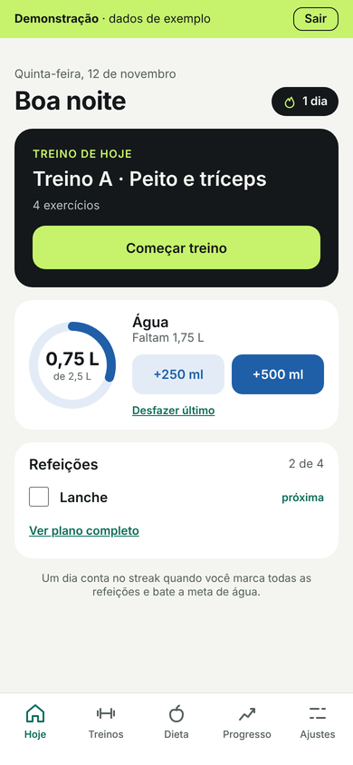
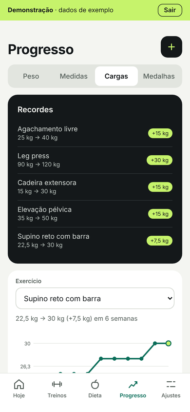
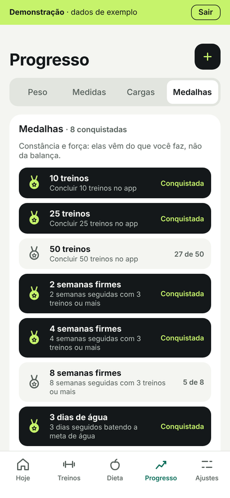
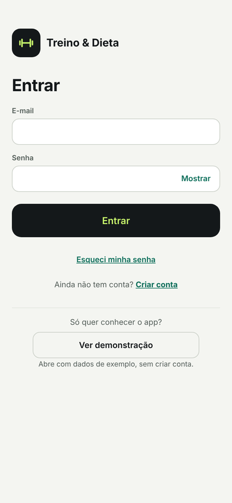

# Treino & Dieta

App mobile-first (PWA) que junta **treino com sugestão de carga, alongamento, dieta com substituições e água** num só lugar, com login e sincronização entre aparelhos.

**[Abrir o app](https://app-treino-dieta-omega.vercel.app)** → toque em **Ver demonstração** para conhecer com dados de exemplo, sem criar conta.

<p>
  
  
  
  
</p>

## Destaques

- **Sugestão de carga**: progressão dupla e pirâmide; o app diz quando subir, manter ou reduzir a carga de cada exercício.
- **Treino em andamento**: série a série, timer de descanso, cardio entre exercícios (treino híbrido), fotos dos exercícios.
- **Dieta com lista de substituição**: troca um alimento por outro do mesmo grupo, já na porção equivalente.
- **Agenda por data**, alongamentos guiados com timer, água com meta e sequência de dias cumpridos.
- **Motivação pelos próprios números**: recordes, marcos, resumo da semana e medalhas de constância (sem foco em peso).
- **Offline primeiro**: tudo funciona sem internet e sincroniza depois; conflitos nunca apagam o que ainda não foi enviado.
- **Privacidade**: Postgres com RLS (cada pessoa só acessa os próprios dados), fotos em armazenamento privado com links temporários, exportar e apagar a conta (RGPD).
- **Importar plano**: dieta, fichas, agenda e fotos novas por arquivo, com prévia do que muda e histórico preservado.

## Stack

React 18 · TypeScript · Vite · Zustand · Supabase (Auth, Postgres + RLS, Storage) · PWA (manifest + service worker) · Vitest + Testing Library · Vercel

## Como rodar

```bash
npm install
npm run dev     # abre em http://localhost:5173
npm test        # testes da store
npm run build   # versão de produção em dist/
```

## Estrutura

```
src/
  data/samplePlan.ts          # plano de EXEMPLO — troque pelo seu
  features/diet/
    DietPage.tsx              # tela Dieta
    MealCard.tsx              # refeição + itens + botão de troca
    SubstitutionSheet.tsx     # folha com os equivalentes (<dialog> nativo)
  lib/                        # datas e formatação de quantidades
  stores/
    useDietStore.ts           # plano e grupos de substituição
    useDayStore.ts            # trocas e refeições feitas, por dia
  types/diet.ts               # Food, MealItem, Meal, SubstitutionGroup
  styles/global.css           # tokens de cor e estilos
```

## Como a substituição funciona

- Cada `MealItem` pode ter um `groupId`. Sem grupo, não aparece o botão de troca.
- `useDayStore.swaps[data][itemId]` guarda o alimento escolhido no dia.
- O hook `useFoodForDay(item)` devolve a troca, se existir, ou o alimento original — os componentes não precisam saber se houve troca.

## Banco de dados e login (Supabase)

Postgres no Supabase (região UE, Paris), com login por e-mail e senha.

| Tabela | O que guarda |
| --- | --- |
| `profiles` | nome e meta de água (criado sozinho no cadastro) |
| `diet_plans` | plano alimentar (documento JSON) |
| `workout_plans` | fichas, agenda e alongamentos (documento JSON) |
| `workout_sessions` | cada treino feito |
| `day_logs` | um dia: refeições feitas, água, trocas |
| `body_entries` | peso e medidas |

- **RLS em todas as tabelas:** cada usuária só lê e escreve as próprias linhas; visitantes sem login não acessam nada.
- **`delete_my_account()`:** apaga a conta e, em cascata, todos os dados (RGPD).
- **Migrações versionadas** em `supabase/migrations/`: o banco pode ser recriado em qualquer Postgres.
- **Acesso concentrado em `src/services/`:** as telas não falam com o Supabase direto.

```bash
cp .env.example .env.local   # URL e chave publicável do Supabase (públicas por natureza)
```

Sem o `.env.local`, o app funciona como antes, só no aparelho.

**Login** (`src/services/auth.ts` + `src/features/auth/`): criar conta com confirmação por e-mail, entrar, sair, esqueci minha senha → nova senha, e apagar conta em Ajustes. Erros do Supabase traduzidos pelos códigos (`invalid_credentials`, `email_not_confirmed`…). No painel do Supabase, **Authentication › URL Configuration** precisa ter o endereço do app em Site URL e Redirect URLs.

### Sincronização (`src/services/sync/`)

Offline primeiro: o app lê e grava no aparelho, e o motor envia só o que mudou.

- Observa as stores e anota o que mudou (`sync-meta` no aparelho, sobrevive a fechar o app).
- Envia ~1,5 s depois de cada mudança; sem internet, guarda e tenta quando volta (`online`) ou ao abrir o app.
- Busca as novidades ao entrar, ao voltar para o app (a cada 30 s no máximo) e quando a internet volta.
- Conta vazia + aparelho com dados → sobe tudo (primeira vez). Aparelho novo → os dados da conta substituem os de exemplo.
- Conflito: vale o último envio, mas o que está pendente no aparelho nunca é sobrescrito.
- Sair envia o que falta e limpa o aparelho; outra conta no mesmo navegador não vê nada da anterior.
- `engine.ts` não conhece o Supabase: recebe um `SyncApi` (real em `supabaseApi.ts`, falso nos testes).
- Fichas, agenda e alongamentos sobem juntos (`workout_plans`). Agenda/alongamentos vazios no servidor não apagam os que vieram com o app. `sync-meta.version` (v2) faz o aparelho que já sincronizava reenviar agenda e alongamentos uma vez.

### Fotos (`src/services/images.ts`)

- Bucket **privado** `exercise-images` no Supabase Storage, uma pasta por conta (`<id>/<nome>.webp`); só a dona lê ou altera (`supabase/migrations/…_exercise_images.sql`).
- No computador com `src/data/private/images`, o app mostra a foto local e, depois de sincronizar, envia as que faltam na conta.
- Nos outros aparelhos, `useImage(nome)` pede links temporários assinados (7 dias, em lote) e guarda no aparelho.
- Apagar a conta apaga as fotos antes.

## Back-end: escanear rótulo (`api/analyze-label.ts`)

Na troca de um alimento, "Tem outro alimento?" tira uma foto do rótulo (ou do alimento) e calcula quanto dá para comer no lugar da porção do plano.

```
App (React)  ──foto reduzida + porção──▶  /api/analyze-label (Vercel Function)
                                              │ 1. confere o código de acesso
                                              │ 2. Claude lê a tabela nutricional (visão + ferramenta → JSON)
                                              │ 3. equivalência calculada em código (src/lib/labelMath.ts)
App  ◀── gramas, macros, avisos ─────────────┘
```

- A chave da API fica só no servidor. O app nunca vê.
- `SCAN_ACCESS_CODE` impede que estranhos usem a função (e gastem seus créditos).
- A IA só **lê**; a conta é feita em código e testada (`labelMath.test.ts`, `api/analyze-label.test.ts`).

### Rodar no computador

```bash
cp .env.example .env.local   # preencha ANTHROPIC_API_KEY e SCAN_ACCESS_CODE
npm run dev                  # o Vite serve /api localmente (plugin em vite.config.ts)
```

### Escanear rótulo na Vercel (quando for ativar)

O botão fica escondido até existir `VITE_SCAN_ENABLED=true` (no `.env.local` e nas variáveis da Vercel).

Em **Settings › Environment Variables**, cadastre `ANTHROPIC_API_KEY` e `SCAN_ACCESS_CODE` e faça um novo deploy. Sem elas, a função responde que o recurso não está configurado.

## Publicar (Vercel) e instalar no celular (PWA)

- `vercel.json`: build do Vite, saída em `dist`, `sw.js` sem cache e `/assets` com cache longo.
- `.env.production`: URL e chave **publishable** do Supabase (públicas por definição; o RLS protege os dados). Nada secreto vai nesse arquivo.
- A Vercel monta o app a partir do GitHub, então **sem** `src/data/private`: o site publicado não contém a dieta, as fichas nem as fotos. Tudo isso chega pela conta depois do login (sincronização + fotos privadas).
- PWA: `public/manifest.webmanifest`, ícones em `public/icons/` (fonte `icon.svg`) e `public/sw.js`, registrado só no build de produção. O service worker guarda as páginas e os arquivos do site para abrir sem internet; dados, login e fotos do Supabase não passam por ele.
- No Supabase, **Authentication › URL Configuration**: Site URL = endereço da Vercel; Redirect URLs = endereço da Vercel e `http://localhost:5173`.

## Agenda, motivação e meus dados

- **Agenda** (Treinos › Editar agenda, `ScheduleEditor.tsx`): calendário do mês; toque no dia e escolha uma ou mais fichas, descanso, ou limpe o dia (aí vale o dia da semana da ficha). Avisa na lista de treinos quando a agenda está acabando.
- **Motivação** (`src/lib/achievements.ts`), só com força e constância, nunca peso:
  - ao finalizar um treino: recordes de carga e marcos (1º, 10º, 25º… treino);
  - na tela Hoje, de segunda a quarta: resumo da semana passada (treinos, dias na meta de água, exercícios com carga maior);
  - Progresso › Medalhas: total de treinos, semanas seguidas com 3+ treinos, dias seguidos de água e exercícios que evoluíram.
- **Baixar meus dados** (Ajustes): arquivo JSON com tudo (backup e RGPD).
- **E-mails em português**: modelos em `supabase/email-templates/`, colados no painel em Authentication › Email Templates.

## Lembretes (Ajustes › Lembretes)

Notificações push de água e de treino, inclusive no iPhone com o app instalado na tela de início.

- **Água**: se você ficar X horas (1h a 3h) sem registrar e ainda faltar para a meta, dentro do horário escolhido. A mensagem diz quanto falta.
- **Treino**: um aviso por dia a partir do horário escolhido, só em dia de treino (agenda ou dia da semana) e se ainda não treinou.
- Como funciona: o aparelho se inscreve (`src/services/reminders.ts`, `public/sw.js`) → a cada 15 min o `pg_cron` chama a Edge Function `send-reminders` (`supabase/functions/send-reminders/`) com uma senha guardada no banco → `logic.ts` decide (testado no Vitest) e o envio usa Web Push com chaves VAPID geradas e guardadas no próprio banco (`app_secrets`, sem acesso pelo app).
- Tabelas `push_subscriptions` e `reminder_settings` com RLS; tudo é apagado junto com a conta; sair da conta para os lembretes naquele aparelho.

## Importar plano (Ajustes › Plano)

Quando chega dieta, treino ou agenda nova, o app recebe um arquivo `.json` (formato `treino-dieta-plano`, versão 1) com qualquer parte: `diet`, `workouts`, `schedule`, `stretches` e `images` (fotos .webp em base64).

- `src/lib/planImport.ts`: confere tudo antes (refeições, grupos de substituição, exercícios, agenda só com fichas que existem, fotos até 2 MB), mostra o resumo do que muda e só aplica depois da confirmação.
- Exercício que continua (mesmo nome, ignorando acentos e maiúsculas) mantém o id e a carga atual: o histórico e a sugestão de carga seguem.
- A agenda nova junta com a antiga (datas iguais são substituídas). Treinos feitos, água, peso e medidas não mudam.
- As mudanças sobem sozinhas pela sincronização; as fotos vão para o armazenamento privado da conta.
- Gerar o arquivo a partir de `src/data/private`: `npx vite-node scripts/export-plan.ts -- --label "Plano de dezembro" --only workouts,schedule --images inf-12 --out plano-dez.json`

## Dados pessoais (fora do Git)

O app procura `src/data/private/dieta.ts` e `src/data/private/treinos.ts`. Se existirem, usa o plano alimentar, as fichas, a agenda por data e os alongamentos reais; se não, usa os exemplos. A pasta está no `.gitignore`, então o repositório público roda só com dados de exemplo. Os testes de `src/data/private-data.test.ts` validam os dados pessoais e são pulados quando a pasta não existe.

## Usando o seu plano

Edite `src/data/samplePlan.ts` com os alimentos, quantidades e equivalências da sua nutricionista. Os valores atuais são só exemplo. Se já abriu o app antes, limpe o localStorage (DevTools › Application › Local Storage) para carregar o plano novo.

## Próximos passos

Treinos com sugestão de carga, água, painel Hoje, progresso e importação do plano a partir do PDF.
